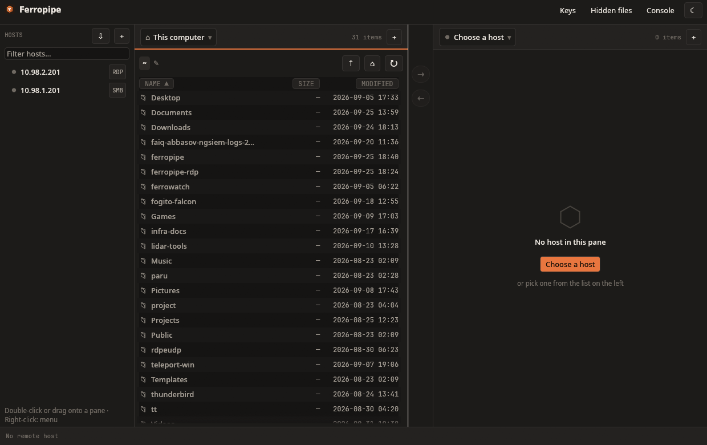
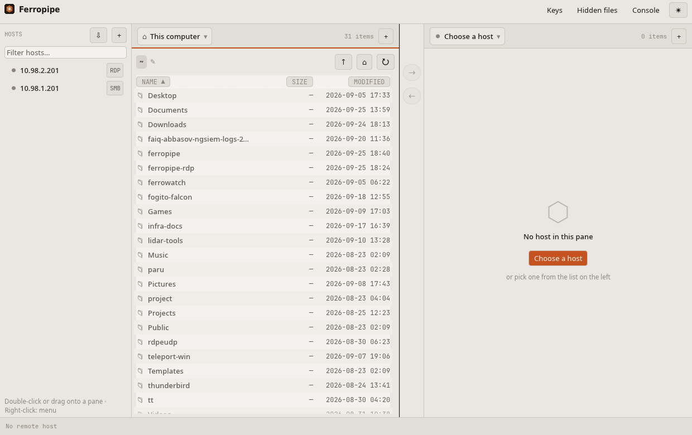

# Ferropipe

A native **Rust** connection manager and file transfer tool — SSH/SFTP, SMB, WinRM, and
RDP — with a **dual-pane file browser**, drag-and-drop transfer (including
**remote-to-remote**), an embedded command console, and live remote-file editing. Built on
[`egui`](https://github.com/emilk/egui). An XPipe/Termius-style client, in one static binary.





## Features

### Connections
- **Four connection types**, each with an encrypted-at-rest password/passphrase:
  - **SSH / SFTP** — native shell exec + file browsing (`ssh2`/libssh2).
  - **SMB / CIFS** — Windows/Samba shares, no SSH needed (`pavao`/libsmbclient). Browse
    shares from the server root, transfer files.
  - **WinRM** — Windows hosts without SSH: browse + transfer (PowerShell + `winrm-rs`
    built-in file transfer) and run commands. Strict TLS by default; per-connection
    "accept invalid cert" opt-in for self-signed :5986.
  - **RDP** — launched via **Remmina** with a tuned profile (GFX AVC444 codec + network
    autodetect for a responsive session). The experimental **native client** (`RDP (Native)`)
    now has a real keyboard: physical-key scancodes (modifiers, arrows, F-keys, AltGr on
    non-US layouts) plus a Ctrl+Alt+Del button in the window strip.
- Nested **groups** (`WIM/Tovuz`, `Shusha Paid Route/27 KM`), search, add/edit/duplicate/delete.
- **Import** hosts from `~/.ssh/config`.
- Auth: password, private-key file (+ passphrase), or ssh-agent.

### Files
- **Dual-pane browser** — either pane shows *this computer* or a host (pick from the
  pane's host pill, or drag a host onto it), resizable splitter, sortable columns,
  multi-select, breadcrumb/editable path bar, up/home/refresh, hidden-file toggle.
- **Drag-and-drop transfer** between panes in any combination — local ⟷ remote,
  remote ⟷ remote, and local → local copies on this machine — recursive directories,
  live progress queue, atomic writes (`.part` + rename), success/failure reporting.
- **Remote-to-remote transfer** — point both panes at hosts and transfer between two
  servers. (Bytes stage through the local machine — true server-to-server isn't possible
  over SFTP/SMB/WinRM; every client relays.)
- **File ops** on both sides — new folder, new file, rename, delete (with confirm).
- **Live remote edit** — right-click → *Edit (live)*: downloads the file, opens it in your
  editor, and auto-re-uploads every time you save.

### Console & terminal
- **Command console** (toggle in the top bar) — run commands on the SSH/WinRM host with
  streamed, colorized stdout/stderr and auto-scroll.
- **Open terminal** — right-click an SSH host → launches your terminal running `ssh`
  (**alacritty** by default; honors `$TERMINAL`, falls back to kitty/wezterm/konsole/…).

### Security
- **Encrypted vault** — AES-256-GCM, 256-bit key in a `0600` file; the `zeroize` feature
  wipes key material. Secrets never hit disk in plaintext.
- **SSH host-key verification** — TOFU against `~/.ssh/known_hosts`; refuses on mismatch.
- **WinRM** — strict TLS by default; PowerShell arguments are safely single-quote-escaped
  (reviewed for injection); temp files are private (`tempfile`, `0600`, auto-removed).

### UX
- **Foundry look** — a warm dark theme and a paper light theme, one rust accent reserved
  for actions, host rows with protocol chips and an optional tag-color stripe, a transfer
  gutter between the panes and a transfer drawer with per-row progress, retry and dismiss.
- **Drag a host onto a pane** to open it there (either pane; RDP hosts open in their own
  window instead), or pick one from the pane's host pill.
- Responsive: all I/O on background worker threads, two concurrent sessions (one per
  pane) so nothing blocks.
- **Function keys**, Commander style — F2 Rename · F4 Edit · F5 Copy · F7 Mkdir ·
  F8 Delete · F9 Console · F10 Hosts · Tab switches pane. They act on the focused pane
  (click a pane to focus it); the legend bar is toggled with "Keys" in the top bar.

## Build & run

Requires a Rust toolchain and: `libssh2`, `openssl`, `libsmbclient` (Arch: `smbclient`),
and — for RDP — `remmina` + `freerdp`.

```bash
cargo run --release
```

Fonts are discovered at runtime (IBM Plex, then Noto Sans / Cantarell / JetBrains Mono,
then DejaVu). To embed IBM Plex in the binary instead, drop the four files listed in
`assets/fonts/README.md` into `assets/fonts/` and build with `--features bundled-fonts`.

## Install

### Arch Linux

`packaging/PKGBUILD` builds the `ferropipe-git` package from the current `HEAD`,
cloning `ferropipe-rdp` and `rdpeudp` alongside it (the crate depends on both as
sibling path dependencies):

```bash
cd packaging && makepkg -si
```

It pulls `libssh2`, `openssl` and `smbclient`, and suggests `remmina` (RDP) and
`alacritty` (default SSH terminal) as optional dependencies. See
[packaging/README.md](packaging/README.md).

### Any distro, per user

`install.sh` builds a release binary and installs it, the desktop entry and the
icon under `~/.local` (`PREFIX=...` to change). Clone `rdpeudp`, `ferropipe-rdp`
and `ferropipe` next to each other first:

```bash
./install.sh
```

## Configuration

Under `~/.config/ferropipe/`:
- `connections.json` — connections + settings (secrets are encrypted blobs, `0600`).
- `vault.key` — the AES key (`0600`). **Back this up.**
- `rdp-profiles/` — generated Remmina profiles.

All options live in the GUI; you should never hand-edit these.

## Architecture

```
main.rs        → load store + vault, launch eframe
theme.rs       → Foundry palette tokens and the egui Visuals/Style pass
  fonts.rs     → runtime font discovery (optional `bundled-fonts` embedding)
widgets/       → state-free Foundry widgets
  host.rs      → status dot, protocol chip, tag stripe, host pill
  path.rs      → breadcrumb path bar
  transfer.rs  → transfer row, gutter arrows
  fkeys.rs     → Commander function-key bar and its key mapping
  misc.rs      → primary button, toast, empty pane, icon button
app.rs         → FerropipeApp: state, worker plumbing, frame loop
  session.rs   → connect / disconnect, worker events, navigation
  sidebar.rs   → hosts sidebar: filter, grouped rows, host menu, host drag
  panes.rs     → file panes: host pill, path bar, listing table, drop targets
  pane_actions.rs → dispatch of pane outcomes (open, transfer, rename, …)
  editor.rs    → add / edit connection form
  transfers.rs → transfer gutter, drawer and bookkeeping (queue, retry, staging)
  fkeys.rs     → function-key handling and the legend bar
  console.rs   → command console
  live_edit.rs → edit-remote-file watcher
  dialogs.rs   → prompts and delete confirmation
  ssh_panel.rs → Windows remote-access panel (enable SSH/WinRM, transfer)
  chrome.rs    → top bar, status bar and toasts
native_rdp.rs  → in-app RDP window: framebuffer texture, keyboard bridge, mouse
remote/        → backend-agnostic worker
  mod.rs       → RemoteFs trait + generic transfer/walk/delete + command loop
  sftp.rs      → SSH connect + host-key verify + SFTP + exec
  smb.rs       → SMB via pavao/libsmbclient
  winrm.rs     → WinRM via winrm-rs (+ PowerShell for dir ops)
  worker.rs    → per-connection dispatch (SSH/SMB/WinRM)
rdp.rs         → Remmina profile generation + launch
external.rs    → terminal / editor launchers
sshconfig.rs   → ~/.ssh/config import
localfs.rs, model.rs, store.rs, vault.rs
```

Two worker threads (one per pane) own their `RemoteFs` backend and talk to the UI over
`mpsc` channels; the UI drains events each frame and requests repaints.

## Tests

```bash
cargo test
```

Covers vault crypto (round-trip / nonce-uniqueness / wrong-key), path helpers,
ssh-config parsing and the local copy planner.

### Live probes (opt-in)

Three `#[ignore]`d tests exercise a real backend end to end against a host you
have already saved in the app. Each reads `~/.config/ferropipe/connections.json`
and the vault, decrypts the saved secret without printing it, and prints
numbered steps. They are skipped unless their environment variable names a saved
connection of the matching kind, so a plain `cargo test` never touches the
network. Run one with `--ignored --nocapture`:

```bash
FERROPIPE_SFTP_PROBE='<saved SSH name>'    cargo test sftp::live_probe  -- --ignored --nocapture
FERROPIPE_SMB_PROBE='<saved SMB name>'     cargo test smb::live_probe   -- --ignored --nocapture
FERROPIPE_WINRM_PROBE='<saved WinRM name>' cargo test winrm::live_probe -- --ignored --nocapture
```

What each one does on the host (the scratch file is `ferropipe-probe-<pid>.txt`
and is removed again, also when an assertion fails halfway):

| Probe | Test | Reads | Writes and removes | Runs |
| --- | --- | --- | --- | --- |
| SSH/SFTP | `sftp::live_probe::sftp_round_trip_against_saved_host` | the login user's home directory listing | the scratch file in the home directory, written through `<name>.ferropipe-part` and renamed | `echo ferropipe-probe` |
| SMB | `smb::live_probe::smb_round_trip_against_saved_host` | the share list, `C$/Windows`, and `C$/Windows/win.ini` (downloaded to a local temp dir) | the scratch file in `C$/Windows/Temp`, written through `<name>.ferropipe-part` and renamed | nothing |
| WinRM | `winrm::live_probe::winrm_round_trip_against_saved_host` | the profile directory listing (`$env:USERPROFILE`) | the scratch file in the profile directory (`C:\Windows\Temp` if no profile resolved), uploaded directly | `hostname` |

The SSH probe uses the saved auth as-is (password, key file with its passphrase,
or ssh-agent) and, like the app, records an unknown host key in
`~/.ssh/known_hosts`. The SMB probe needs an account that can read `C$`; the
WinRM probe needs WinRM enabled on the host (`:5985`, or `:5986` for TLS).

## CI

`.github/workflows/ci.yml` builds, tests, runs clippy (`-D warnings`) and
`cargo fmt --check` on every push and pull request, plus an advisory
`cargo audit` job that does not block merges. Because the crate depends on
`../ferropipe-rdp` (which depends on `../rdpeudp`), the workflow checks the three
repositories out side by side (`ferropipe/`, `ferropipe-rdp/`, `rdpeudp/`) and
runs cargo from `ferropipe/`; `nicatmhmmdv/ferropipe-rdp` and
`nicatmhmmdv/rdpeudp` therefore have to be published on GitHub for the workflow
to pass (and, if private, need a read token on their checkout steps).
`ferropipe-rdp` has the same workflow, checking out `rdpeudp` next to itself.

## Notes & roadmap

- **Tiling WMs** (Hyprland/sway) size the window themselves; float it with
  `hyprctl keyword windowrulev2 'float,class:^(Ferropipe)$'`.
- Roadmap: streaming remote-to-remote (through memory, no temp file), SSH port-forward
  tunnels, chmod/permissions dialog, a pure-Rust SSH transport (`russh`), and a tabbed
  **Sessions** layout (plan in [docs/sessions-plan.md](docs/sessions-plan.md)).

## License

MIT.
